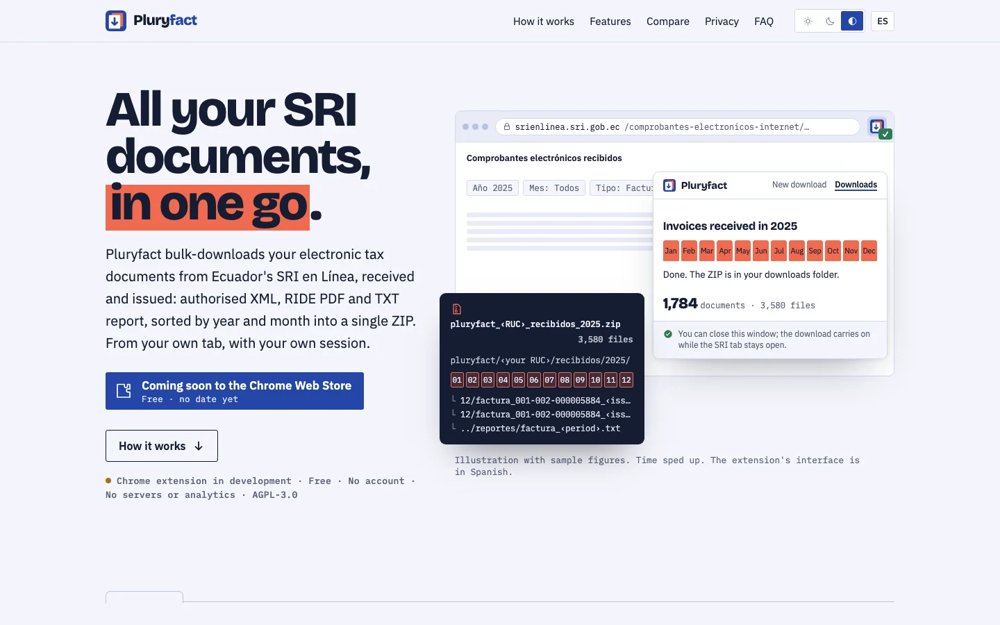

<p align="center">
  <a href="https://pluryfact.maecly.com/en/"></a>
</p>

<h1 align="center">All your SRI documents, in one go.</h1>

<p align="center">
  <b>Pluryfact</b> is a Chrome extension that bulk-downloads your electronic tax documents from Ecuador's SRI en Línea:<br>
  authorised XML, RIDE (PDF) and the TXT report, sorted by year and month in a single ZIP.
</p>

<p align="center">
  <b>Free</b> · <b>No account</b> · <b>No password asked</b> · <b>Open source</b>
</p>

<p align="center">
  <a href="https://github.com/MAECLY/pluryfact/releases/latest"></a>
  <a href="https://chromewebstore.google.com/detail/pluryfact/ibgodfpcihlddbbfaoooehfgbmahipbj"></a>
  <a href="https://github.com/MAECLY/pluryfact/releases"></a>
  <a href="https://github.com/MAECLY/pluryfact/stargazers"></a>
  <a href="https://hits.sh/github.com/MAECLY/pluryfact/"></a>
  <a href="https://github.com/MAECLY/pluryfact/commits/main"></a>
  <a href="LICENSE"></a>
  <a href="#install"></a>
  <a href="#how-it-looks-after-your-account"></a>
  <a href="#how-it-looks-after-your-account"></a>
  <a href="#development"></a>
</p>

<p align="center">
  <a href="https://pluryfact.maecly.com/en/"><b>Website</b></a> ·
  <a href="https://chromewebstore.google.com/detail/pluryfact/ibgodfpcihlddbbfaoooehfgbmahipbj"><b>Add to Chrome</b></a> ·
  <a href="#install">Install</a> ·
  <a href="#how-it-looks-after-your-account">Privacy</a> ·
  <a href="#limits">Limits</a> ·
  <a href="#development">Development</a> ·
  <a href="https://github.com/MAECLY/pluryfact/releases/latest">Download</a> ·
  <a href="CHANGELOG.md">Changelog</a> ·
  <a href="https://github.com/MAECLY/pluryfact/issues/new">Report a bug</a> ·
  <b>English</b> · <a href="README.md">Español</a>
</p>

<p align="center">
  <picture>
    <source media="(prefers-color-scheme: dark)" srcset=".github/assets/readme/hero-en-1440-dark.webp">
    
  </picture>
</p>

> [!NOTE]
> **Version 0.2.0, said plainly.** It adds optional printing with
> [Pluryprint](https://pluryprint.maecly.com) 0.0.6 or later. The core
> (reading the portal's tables, access keys, the query plan and the filters)
> has automated tests, and the XML, RIDE and TXT downloads were validated with
> real portal sessions; the Pluryprint handoff has end-to-end tests with a
> native host. Version **0.1.0 is on the
> [Chrome Web Store](https://chromewebstore.google.com/detail/pluryfact/ibgodfpcihlddbbfaoooehfgbmahipbj)**; 0.2.0 is already a ZIP in the
> [releases](https://github.com/MAECLY/pluryfact/releases) and still has to pass the store review. Printing with
> Pluryprint only switches on with the Pluryfact installed from the store: the
> ZIP does not activate it. If
> something breaks, an [issue](https://github.com/MAECLY/pluryfact/issues/new)
> with the diagnostic log (Avanzado → Copiar registro) helps a lot.

---

## What it does

**Received and issued.** It works on both SRI en Línea screens,
*Comprobantes electrónicos recibidos* and *emitidos*, each with its own query
plan.

**The period you need.** One day, a date range, a month or a whole year.
Issued documents go up to yesterday; received ones, up to today.

**Filter by issuer.** On received documents, keep only one supplier by RUC or
business name, ignoring accents and capitals.

**XML, RIDE and report.** The authorised XML, which is the document with tax
validity; the RIDE, its printed representation as a PDF; and the TXT report of
the listing.

**One sorted ZIP.**

```text
pluryfact_<RUC>_recibidos_2025.zip
└── pluryfact/<RUC>/recibidos/2025/
    ├── 01/  <type>_<series>_<issuer RUC>_<access key>.xml / .pdf
    ├── 02/
    └── …
```

**Few queries, on purpose.** Received documents are queried one month at a
time: a year of invoices is 12 queries, not 365. Issued documents go day by day
because that SRI screen does not accept ranges.

**Close the popup, keep downloading.** The toolbar badge shows the progress.
You get a notification when the job ends, when the session expires or on an
error; never one per month.

**Resume after an expired session.** An SRI session lasts about 20 minutes.
Pluryfact notices, keeps what it already fetched and offers **Resume**: only
what is missing.

**History and eight themes.** A page of its own lists your jobs, their state
and what is still pending, like `chrome://downloads`. Pick one of eight colour
and type themes; Pluryfact is the default.

**Print with Pluryprint (in development).** Connect
[Pluryprint](https://pluryprint.maecly.com/), MAECLY's batch printing app for
Windows and macOS, and send it the RIDEs, the XMLs (Pluryprint renders a
RIDE-like printout from them) or both, plus the report, right after a download
or from any past ZIP. Pluryprint opens so you review and confirm before any
paper is used. It arrives with Pluryfact 0.2 and Pluryprint 0.0.6; see
[docs/INTEGRACION-PLURYPRINT.md](docs/INTEGRACION-PLURYPRINT.md).

## How it looks after your account

- **It never asks for your SRI password.** You sign in to SRI en Línea yourself,
  as always. Pluryfact works inside that tab, with that session, and never
  stores it.
- **On the internet, it only talks to the SRI.** `srienlinea.sri.gob.ec` with
  your session, and `cel.sri.gob.ec`, the SRI's public authorisation web
  service, for the XML. There is no Pluryfact server and no analytics. Off the
  internet, it only talks to Pluryprint on your own computer, and only if you
  connect it.
- **It queries at a human pace.** One query at a time, with random pauses.
  If the SRI asks for a reCAPTCHA check, Pluryfact pauses, brings the SRI tab
  to the front and carries on once you solve it. It never solves or bypasses
  captchas: see [docs/CAPTCHA.md](docs/CAPTCHA.md).

| Permission | Why |
|---|---|
| `srienlinea.sri.gob.ec/comprobantes-electronicos-internet/*` | Press Consultar and download the files on the documents screen, with your session. |
| `cel.sri.gob.ec/*` | Request the authorised XML of each access key from the SRI's public service. |
| `storage` | Keep progress, history and your settings in this browser. |
| `scripting` | Activate Pluryfact in an SRI tab that was already open. |
| `notifications` | Tell you when a download finishes or your session expires. |
| `nativeMessaging` (optional, from 0.2.0) | Only if you connect Pluryprint in Integrations: hand it, on your computer, the RIDEs, XMLs and report you choose to print. Chrome asks for it separately; Disconnect removes it. |

Nothing else: no access to other sites, your tabs, your history or your
cookies.

## Limits

- **It is not an official SRI tool.** Pluryfact is not affiliated with the
  Servicio de Rentas Internas.
- **It does not sign in for you.** It only works in a tab with a signed-in
  session.
- **A full year may need resuming** two or three times, because of the
  20-minute session.
- **Old issued documents may come without XML.** The SRI web service rejects
  some issue dates; Pluryfact tries the portal instead and tells you what it
  could not get.
- **Chrome only.** It does not export Excel, ledgers or the ATS: it delivers
  the files as the SRI hands them out. Its interface is in Spanish.

## How it compares

Based on each product's public listing in November 2026. Products were not
installed or tested.

| | Pluryfact | XML Manager | Descargador Masivo (docu.ec) | Comprobantes SRI (CUENCOR) | recibo.ec |
|---|---|---|---|---|---|
| Price | Free, no paid tier | Not stated | Recent periods free; one-off payment for long periods | Paid, per computer (7-day trial) | Free up to 200 a month, then paid plans |
| Password and session | Never asked, never leave the browser | Not stated | Sends your session cookie to its servers | Automatic mode keeps your password encrypted on your computer | Optional: you connect your SRI password |
| Formats | XML + RIDE PDF + TXT report in one ZIP | XML of received, TXT and PDF reports | XML and PDF (Excel in the paid mode) | XML, RIDE PDF, Excel and ATS | XML, PDF, XLSX and CSV |
| After an error | Resumes only what was missing, also after the session expires | Not stated | Not stated | Not stated | Not stated |
| Open source | AGPL-3.0 | Not stated | Not stated | Not stated | Not stated |

**Where others are ahead:** accounting reports (purchase and sales ledgers,
ATS, Excel), unattended sync and track record. **The difference:** free and
AGPL, neither your password nor your session cookie leaves your browser, and
it resumes after an expired session. The full comparison, with sources, is on
the [website](https://pluryfact.maecly.com/en/#comparar).

## Install

**Chrome Web Store (recommended):** open the
[Pluryfact listing](https://chromewebstore.google.com/detail/pluryfact/ibgodfpcihlddbbfaoooehfgbmahipbj) and click **Add to Chrome**. Chrome keeps it up to
date.

**Manually, from GitHub:**

1. Download `pluryfact-0.2.0-chrome.zip` from the
   [latest release](https://github.com/MAECLY/pluryfact/releases/latest) and
   unzip it into a folder you will keep.
2. Open `chrome://extensions` and turn on **Developer mode**.
3. Click **Load unpacked** and pick that folder.
4. Sign in to [SRI en Línea](https://srienlinea.sri.gob.ec/), open
   **Facturación electrónica → Comprobantes electrónicos recibidos** (or
   *emitidos*) from the menu, and click the Pluryfact icon.

To update a manual install, unzip the new version over the same folder and
press the reload button on the extension's card. The ID of an unpacked
extension depends on the folder path, so loading it from another folder starts
with an empty history. To build it from source, see
[Development](#development).

## Development

You need [Bun](https://bun.sh/) 1.4 or newer and Chrome.

```sh
bun install                 # install dependencies (also runs `wxt prepare`)
bun run dev                 # Chrome with the extension loaded and live reload
bun run check               # typecheck, unit tests (Vitest) and a production build
bun run build               # build into .output/chrome-mv3
bun run zip                 # build the release zip into .output/
bun run icons               # re-render public/icon/*.png from design/icon/*.svg
bun run e2e                 # real test against the portal (opens Chromium; you sign in)
bun run e2e:pluryprint      # "Print a ZIP…" end to end with a native host (fake, or PLURYPRINT_BRIDGE_BIN)
bun run validar-zip [path]  # validate the latest pluryfact_*.zip in ~/Downloads
bun run registro [--errores] [--ultimos N]   # read the diagnostic log from your Chrome profiles
```

The diagnostic log lives in `chrome.storage.local` (on disk:
`<Chrome profile>/Local Extension Settings/<id>/`). It keeps up to 2000
entries per part of the extension, with RUCs and access keys masked.

### Architecture

```text
popup  →  background  →  content script  →  conductor (page's MAIN world)
```

| Piece | Files | What it does |
|---|---|---|
| **popup** | `src/entrypoints/popup/` | Inbox, period, types, issuer and formats; progress, pause and resume. |
| **full page** | `src/entrypoints/pluryfact/` | History, settings and themes; also the options page. |
| **background** | `src/entrypoints/background.ts`, `src/lib/sri-ws.ts`, `puente-pluryprint.ts` | XML from the public web service, badge and notifications, and the only bridge to Pluryprint (`connectNative`). |
| **content script** | `src/entrypoints/sri.content.ts`, `src/lib/cola.ts`, `extract.ts`, `jsf.ts`, `reporte.ts`, `zip.ts`, `historial.ts` | Job queue, pace and retries; reads the portal's tables and ViewState; downloads the RIDE and the TXT report with same-origin POSTs; builds and saves the ZIP; history. |
| **Pluryprint** | `src/lib/pluryprint.ts`, `seleccion-impresion.ts`, `envio-pluryprint.ts` | Protocol client, what to print and in which order, and the send with the user's settings. |
| **conductor** | `src/entrypoints/conductor.content.ts`, `src/lib/conductor.ts` | Fills the portal's own controls and presses its Consultar button, so the ViewState, PrimeFaces updates and reCAPTCHA stay the SRI's. |
| **core** | `src/lib/clave.ts`, `periodo.ts`, `filtro.ts`, `archivos.ts`, `selectors.ts` | Access key parts and modulo-11 check digit, query plan, filters, folder and file names, and the only place with portal ids. |

More detail:

- [docs/ARQUITECTURA.md](docs/ARQUITECTURA.md): the pieces and the flow per month.
- [docs/INTEGRACION-PLURYPRINT.md](docs/INTEGRACION-PLURYPRINT.md): printing with Pluryprint, options weighed, protocol, security and the full operations matrix.
- [docs/REFERENCE.md](docs/REFERENCE.md): anatomy of the SRI screens.
- [docs/CAPTCHA.md](docs/CAPTCHA.md): how the reCAPTCHA works and why Pluryfact leaves it to you.
- [docs/design-system.md](docs/design-system.md): colours, type, themes and voice.

The website, [pluryfact.maecly.com](https://pluryfact.maecly.com/), is built from a private repository.

## Credits

- [WXT](https://wxt.dev/), [Tailwind CSS](https://tailwindcss.com/),
  [Vitest](https://vitest.dev/) and [Playwright](https://playwright.dev/).
- Fonts from [Fontsource](https://fontsource.org/): IBM Plex, Bricolage
  Grotesque and the faces of the eight themes, under the SIL Open Font License.

Pluryfact is not affiliated with the Servicio de Rentas Internas (SRI). RIDEs
are printed representations; the document with tax validity is the authorised
XML.

## Licence

Pluryfact is free software, licensed under the
[GNU Affero General Public License v3.0 only](LICENSE) (`AGPL-3.0-only`).
Copyright © 2026 Miguel Angel Esparza Calero (MAECLY).

---

<p align="center">
  <sub>Made by Miguel Angel Esparza Calero · <a href="https://pluryfact.maecly.com/en/">pluryfact.maecly.com</a> · part of <a href="https://www.maecly.com">MAECLY</a></sub>
</p>
