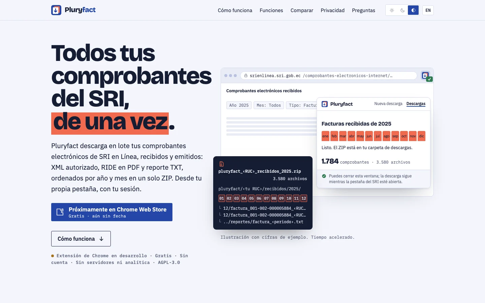

<p align="center">
  <a href="https://pluryfact.maecly.com/"></a>
</p>

<h1 align="center">Todos tus comprobantes del SRI, de una vez.</h1>

<p align="center">
  <b>Pluryfact</b> es una extensión de Chrome que descarga en lote tus comprobantes electrónicos de SRI en Línea:<br>
  XML autorizado, RIDE (PDF) y reporte TXT, ordenados por año y mes en un solo ZIP.
</p>

<p align="center">
  <b>Gratis</b> · <b>Sin cuenta</b> · <b>No pide tu clave</b> · <b>Código abierto</b>
</p>

<p align="center">
  <a href="https://github.com/MAECLY/pluryfact/releases/latest"></a>
  <a href="#instalar"></a>
  <a href="https://github.com/MAECLY/pluryfact/releases"></a>
  <a href="https://github.com/MAECLY/pluryfact/stargazers"></a>
  <a href="https://hits.sh/github.com/MAECLY/pluryfact/"></a>
  <a href="https://github.com/MAECLY/pluryfact/commits/main"></a>
  <a href="LICENSE"></a>
  <a href="#instalar"></a>
  <a href="#cómo-cuida-tu-cuenta"></a>
  <a href="#cómo-cuida-tu-cuenta"></a>
  <a href="#desarrollo"></a>
</p>

<p align="center">
  <a href="https://pluryfact.maecly.com/"><b>Sitio web</b></a> ·
  <a href="#instalar">Instalar</a> ·
  <a href="#cómo-cuida-tu-cuenta">Privacidad</a> ·
  <a href="#límites">Límites</a> ·
  <a href="#desarrollo">Desarrollo</a> ·
  <a href="https://github.com/MAECLY/pluryfact/releases/latest">Descargar</a> ·
  <a href="CHANGELOG.md">Cambios</a> ·
  <a href="https://github.com/MAECLY/pluryfact/issues/new">Reportar un problema</a> ·
  <a href="README.md">English</a> · <b>Español</b>
</p>

<p align="center">
  <picture>
    <source media="(prefers-color-scheme: dark)" srcset=".github/assets/readme/hero-es-1440-dark.webp">
    
  </picture>
</p>

> [!NOTE]
> **Versión 0.1.0, dicho claro.** Es la primera versión pública: el núcleo
> (lectura de las tablas del portal, clave de acceso, plan de consultas y
> filtros) tiene pruebas automáticas, y las descargas de XML, RIDE y TXT se
> validaron con sesiones reales del portal. Está **en revisión en Chrome Web
> Store**; mientras tanto se instala a mano desde la
> [última versión](https://github.com/MAECLY/pluryfact/releases/latest). Si
> algo falla, un [issue](https://github.com/MAECLY/pluryfact/issues/new) con el
> registro de diagnóstico (Avanzado → Copiar registro) ayuda mucho.

---

## Qué hace

**Recibidos y emitidos.** Funciona en las dos pantallas de SRI en Línea,
*Comprobantes electrónicos recibidos* y *emitidos*, cada una con su propio plan
de consultas.

**El periodo que necesites.** Un día, un rango de fechas, un mes o un año
completo. Emitidos llega hasta ayer; recibidos, hasta hoy.

**Filtro por emisor.** En recibidos, quédate solo con un proveedor por su RUC o
su razón social, sin importar tildes ni mayúsculas.

**XML, RIDE y reporte.** El XML autorizado, que es el documento con validez
tributaria; el RIDE, su representación impresa en PDF; y el reporte TXT del
listado.

**Un solo ZIP ordenado.**

```text
pluryfact_<RUC>_recibidos_2025.zip
└── pluryfact/<RUC>/recibidos/2025/
    ├── 01/  <tipo>_<serie>_<RUC emisor>_<clave>.xml / .pdf
    ├── 02/
    └── …
```

**Pocas consultas, a propósito.** Recibidos se consulta un mes por vez: un año
de facturas son 12 consultas, no 365. Emitidos va día por día porque esa
pantalla del SRI no admite rangos.

**Cierra el popup, sigue bajando.** La insignia del ícono muestra el avance.
Recibes una notificación al terminar, si la sesión caduca o ante un error;
nunca una por mes.

**Reanuda tras una sesión caducada.** La sesión del SRI dura unos 20 minutos.
Pluryfact lo nota, guarda lo bajado y te ofrece **Reanudar**: solo lo que faltó.

**Historial y ocho temas.** Una página propia con tus trabajos, su estado y lo
que quedó pendiente, como `chrome://downloads`. Elige uno de ocho temas de color
y tipografía; Pluryfact es el predeterminado.

## Cómo cuida tu cuenta

- **Nunca pide tu clave del SRI.** Entras tú a SRI en Línea, como siempre.
  Pluryfact trabaja dentro de esa pestaña, con esa sesión, y nunca la guarda.
- **Solo habla con el SRI.** `srienlinea.sri.gob.ec` con tu sesión, y
  `cel.sri.gob.ec`, el servicio web público de autorización del SRI, para el
  XML. No hay servidor de Pluryfact ni analítica.
- **Consulta a ritmo humano.** Una consulta a la vez, con pausas al azar. Si el
  SRI pide verificar el reCAPTCHA, Pluryfact se pausa, trae al frente la pestaña
  del SRI y sigue cuando lo resuelves. Nunca resuelve ni evita captchas: ver
  [docs/CAPTCHA.md](docs/CAPTCHA.md).

| Permiso | Para qué |
|---|---|
| `srienlinea.sri.gob.ec/comprobantes-electronicos-internet/*` | Pulsar Consultar y bajar los archivos en la pantalla de comprobantes, con tu sesión. |
| `cel.sri.gob.ec/*` | Pedir el XML autorizado de cada clave de acceso al servicio público del SRI. |
| `storage` | Guardar el avance, el historial y tus ajustes en este navegador. |
| `scripting` | Activar Pluryfact en una pestaña del SRI que ya estaba abierta. |
| `notifications` | Avisarte cuando termina una descarga o si tu sesión caduca. |

Y nada más: no pide acceso a otros sitios, a tus pestañas, a tu historial ni a
tus cookies.

## Límites

- **No es una herramienta oficial del SRI.** Pluryfact no está afiliado al
  Servicio de Rentas Internas.
- **No inicia sesión por ti.** Solo trabaja en una pestaña con la sesión
  iniciada.
- **Un año completo puede pedir reanudar** dos o tres veces, por la sesión de
  20 minutos.
- **Emitidos antiguos pueden llegar sin XML.** El servicio web del SRI rechaza
  algunas fechas de emisión; Pluryfact lo intenta desde el portal y te dice qué
  no pudo bajar.
- **Solo Chrome.** No exporta Excel, libros contables ni ATS: entrega los
  archivos tal como los da el SRI.

## Cómo se compara

Según la ficha pública de cada producto en noviembre de 2026. No se instalaron
ni se probaron.

| | Pluryfact | XML Manager | Descargador Masivo (docu.ec) | Comprobantes SRI (CUENCOR) | recibo.ec |
|---|---|---|---|---|---|
| Precio | Gratis, sin versión de pago | No consta | Periodos recientes gratis; pago único para periodos largos | De pago, por equipo (7 días de prueba) | Gratis hasta 200 al mes, luego planes de pago |
| Tu clave y tu sesión | Ni la pide ni salen del navegador | No consta | Envía tu cookie de sesión a sus servidores | El modo automático guarda tu clave cifrada en tu equipo | Opcional: conectas tu clave del SRI |
| Formatos | XML + RIDE PDF + reporte TXT en un ZIP | XML de recibidos, reportes TXT y PDF | XML y PDF (Excel en el modo de pago) | XML, RIDE PDF, Excel y ATS | XML, PDF, XLSX y CSV |
| Si algo se corta | Reanuda solo lo que faltó, también si caduca la sesión | No consta | No consta | No consta | No consta |
| Código abierto | AGPL-3.0 | No consta | No consta | No consta | No consta |

**Donde otros van por delante:** reportes contables (libros de compras y
ventas, ATS, Excel), sincronización desatendida y trayectoria. **La diferencia:**
gratis y AGPL, ni tu clave ni tu cookie de sesión salen de tu navegador, y
reanuda tras una sesión caducada. La comparativa completa, con fuentes, está en
el [sitio](https://pluryfact.maecly.com/#comparar).

## Instalar

**Chrome Web Store:** la versión 0.1.0 está en revisión. Cuando la tienda la
apruebe, se instala con un clic desde su ficha.

**A mano, desde GitHub (mientras tanto):**

1. Descarga `pluryfact-0.1.0-chrome.zip` de la
   [última versión](https://github.com/MAECLY/pluryfact/releases/latest) y
   descomprímelo en una carpeta que no vayas a borrar.
2. Abre `chrome://extensions` y activa el **Modo de desarrollador**.
3. Pulsa **Cargar descomprimida** y elige esa carpeta.
4. Entra a [SRI en Línea](https://srienlinea.sri.gob.ec/), abre desde el menú
   **Facturación electrónica → Comprobantes electrónicos recibidos** (o
   *emitidos*) y pulsa el ícono de Pluryfact.

Para actualizar una instalación manual, descomprime la nueva versión sobre la
misma carpeta y pulsa el botón de recarga en la tarjeta de la extensión. El ID
de una extensión descomprimida depende de la ruta de la carpeta: si la cargas
desde otra carpeta, empieza con el historial vacío. Para compilarla desde el
código, ver [Desarrollo](#desarrollo).

## Desarrollo

Requiere [Bun](https://bun.sh/) 1.4 o posterior y Chrome.

```sh
bun install                 # instala dependencias (también corre `wxt prepare`)
bun run dev                 # Chrome con la extensión cargada y recarga en caliente
bun run check               # typecheck, tests unitarios (Vitest) y build de producción
bun run build               # compila en .output/chrome-mv3
bun run zip                 # arma el zip de la versión en .output/
bun run icons               # regenera public/icon/*.png desde design/icon/*.svg
bun run e2e                 # prueba real con el portal (abre Chromium; el login lo haces tú)
bun run validar-zip [ruta]  # valida el último pluryfact_*.zip de ~/Downloads
bun run registro [--errores] [--ultimos N]   # lee el registro de diagnóstico de tus perfiles de Chrome
```

El registro de diagnóstico vive en `chrome.storage.local` (en disco:
`<perfil de Chrome>/Local Extension Settings/<id>/`). Guarda hasta 2000
entradas por parte de la extensión, con RUC y claves enmascarados.

### Arquitectura

```text
popup  →  background  →  content script  →  conductor (MAIN world de la página)
```

| Pieza | Archivos | Qué hace |
|---|---|---|
| **popup** | `src/entrypoints/popup/` | Bandeja, periodo, tipos, emisor y formatos; avance, pausa y reanudar. |
| **página completa** | `src/entrypoints/pluryfact/` | Historial, ajustes y temas; también es la página de opciones. |
| **background** | `src/entrypoints/background.ts`, `src/lib/cola.ts`, `zip.ts`, `sri-ws.ts`, `historial.ts` | Cola de trabajos, ritmo y reintentos, XML del servicio web público, ZIP y `chrome.downloads`, historial, insignia y notificaciones. |
| **content script** | `src/entrypoints/sri.content.ts`, `src/lib/extract.ts`, `jsf.ts`, `reporte.ts` | Lee las tablas y el ViewState del portal; baja el RIDE y el reporte TXT con POST del mismo origen. |
| **conductor** | `src/entrypoints/conductor.content.ts`, `src/lib/conductor.ts` | Rellena los controles del propio portal y pulsa su botón Consultar, así el ViewState, las actualizaciones de PrimeFaces y el reCAPTCHA siguen siendo los del SRI. |
| **núcleo** | `src/lib/clave.ts`, `periodo.ts`, `filtro.ts`, `archivos.ts`, `selectors.ts` | Partes de la clave de acceso y dígito verificador módulo 11, plan de consultas, filtros, carpetas y nombres de archivo, y el único lugar con ids del portal. |

Más detalle:

- [docs/ARQUITECTURA.md](docs/ARQUITECTURA.md): las piezas y el flujo por mes.
- [docs/REFERENCE.md](docs/REFERENCE.md): anatomía de las pantallas del SRI.
- [docs/CAPTCHA.md](docs/CAPTCHA.md): cómo funciona el reCAPTCHA y por qué Pluryfact te lo deja a ti.
- [docs/design-system.md](docs/design-system.md): colores, tipografía, temas y voz.

El sitio web, [pluryfact.maecly.com](https://pluryfact.maecly.com/), se publica desde un repositorio privado.

## Créditos

- [WXT](https://wxt.dev/), [Tailwind CSS](https://tailwindcss.com/),
  [Vitest](https://vitest.dev/) y [Playwright](https://playwright.dev/).
- Fuentes de [Fontsource](https://fontsource.org/): IBM Plex, Bricolage
  Grotesque y las tipografías de los ocho temas, bajo la SIL Open Font License.

Pluryfact no está afiliado al Servicio de Rentas Internas (SRI). Los RIDE son
representaciones impresas; el documento con validez tributaria es el XML
autorizado.

## Licencia

Pluryfact es software libre, bajo la
[GNU Affero General Public License v3.0 only](LICENSE) (`AGPL-3.0-only`).
Copyright © 2026 Miguel Angel Esparza Calero (MAECLY).

---

<p align="center">
  <sub>Hecho por Miguel Angel Esparza Calero · <a href="https://pluryfact.maecly.com/">pluryfact.maecly.com</a> · parte de <a href="https://www.maecly.com">MAECLY</a></sub>
</p>
