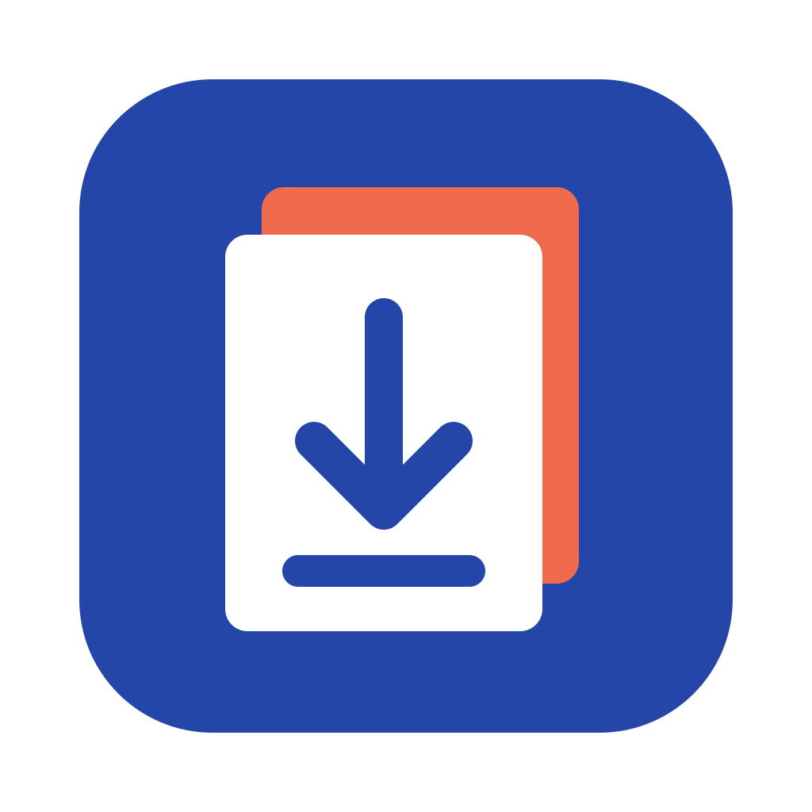

<p align="center"></p>

<h1 align="center">Tus comprobantes del SRI, en un solo legajo.</h1>

<p align="center">
  <b>Legajo</b> es una extensión de navegador que descarga en lote tus comprobantes electrónicos de SRI en Línea: XML, RIDE (PDF) y el reporte del listado.<br>
  Gratis · Sin cuenta · Código abierto (AGPL-3.0) · by MAECLY
</p>

> **Estado:** en desarrollo. El núcleo (lectura de tablas, clave de acceso, plan de consultas, filtros) está probado con fixtures; la conexión con el portal se valida con sesión real antes de la primera versión.

## Qué hace

- **Recibidos y emitidos**, en las dos pantallas de consulta de SRI en Línea.
- **Periodo:** un día, un rango de fechas, un mes o un año completo.
- **Filtro por emisor** en recibidos: RUC o razón social (sin importar tildes ni mayúsculas).
- **Formatos:** XML, RIDE en PDF y reporte TXT del listado.
- **Orden:** `legajo/<tu RUC>/<recibidos|emitidos>/<año>/<mes>/<tipo>_<serie>_<RUC emisor>_<clave>.xml`.
- **Pocas consultas:** recibidos se consulta un mes por vez (un año de facturas = 12 consultas), emitidos un día por vez porque la pantalla no admite rangos.

## Cómo cuida tu cuenta

- Usa la sesión que ya iniciaste en tu navegador. **No pide ni guarda tu clave del SRI.**
- No envía tus datos a ningún servidor: todo pasa entre tu navegador y SRI en Línea.
- Consulta a ritmo humano. Si el SRI pide verificar el reCAPTCHA, Legajo se pausa y te avisa; sigue cuando lo resuelves. Detalle en [docs/CAPTCHA.md](docs/CAPTCHA.md).

## Desarrollo

Requiere [Bun](https://bun.sh) 1.4+ y Chrome.

```sh
bun install
bun run dev      # Chrome con la extensión cargada y recarga en caliente
bun run check    # typecheck + tests + build
bun run icons    # regenera public/icon/*.png desde design/icon/*.svg
bun run e2e      # prueba real con el portal (abre Chromium; el login lo haces tú)
bun run validar-zip [ruta]   # valida el último legajo_*.zip de ~/Downloads
bun run registro [--errores] [--ultimos N]   # lee el registro de diagnóstico de tus perfiles de Chrome
```

El registro de diagnóstico vive en `chrome.storage.local` (en disco: `<perfil de Chrome>/Local Extension Settings/<id>/`). Guarda hasta 2000 entradas por parte de la extensión, con RUC y claves enmascarados.

- [docs/REFERENCE.md](docs/REFERENCE.md): anatomía de las pantallas del SRI.
- [docs/ARQUITECTURA.md](docs/ARQUITECTURA.md): piezas de la extensión y estado de cada una.
- [docs/design-system.md](docs/design-system.md): colores, tipografía y voz.

## Aviso

Legajo no está afiliado al Servicio de Rentas Internas. Los RIDE descargados son representaciones impresas; el documento con validez tributaria es el XML autorizado.

## Licencia

[AGPL-3.0](LICENSE) © MAECLY
